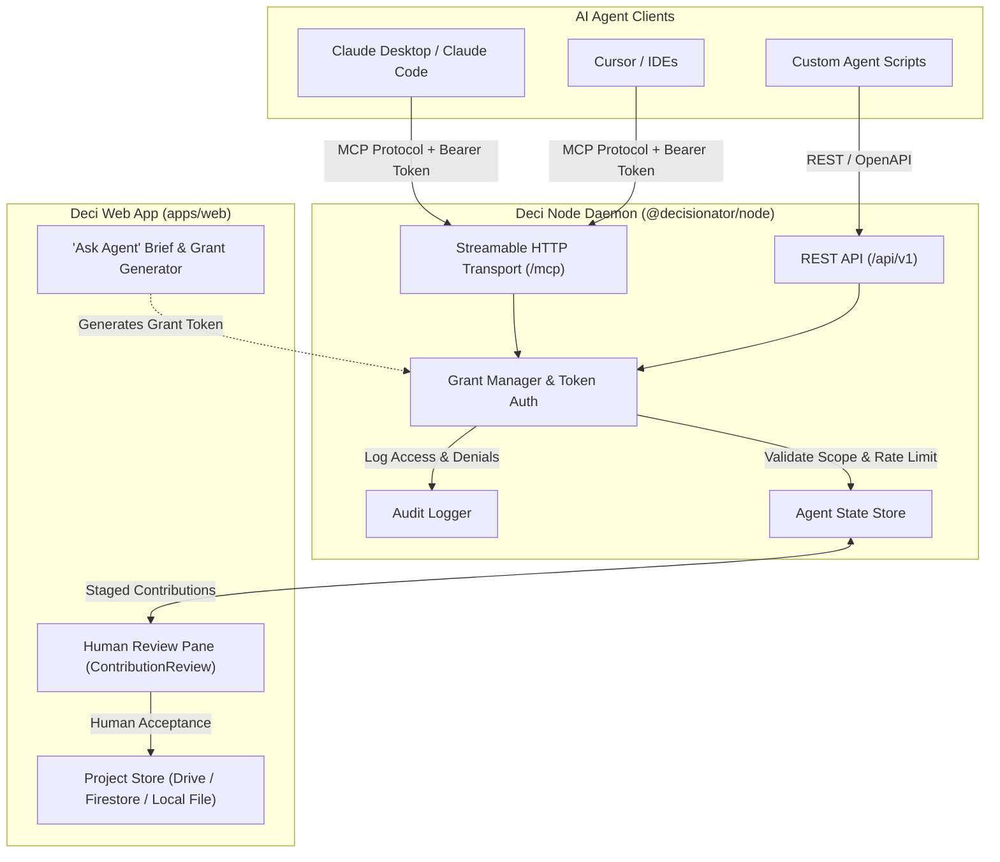

# Agentic Model Context Protocol (MCP) Integration

Deci provides an agent-native decision engine. In addition to manual deliberation and copy-paste prompts, Deci features a companion daemon (`@decisionator/node`) that exposes a Model Context Protocol (MCP) server alongside a twin REST API.

Through MCP, autonomous AI agents (such as Claude Desktop, Claude Code, Cursor, Antigravity, or custom agents) can inspect decision contexts, contribute research notes and pros/cons, propose new candidate options, and recommend session moderation actions—all under strict human-in-the-loop governance.

---

## Architecture & Principles

Deci's agent integration is built on five core principles:

1. **Dual-Transport Parity (Principle IV)**: Both the MCP Streamable HTTP transport and the REST API are generated from the same Zod schemas (`packages/node/src/agent-api/schemas.ts`), ensuring 100% feature parity.
2. **Zero-Trust, Scoped Grants (FR-040, FR-042)**: Agents never get open database or project-wide administrative credentials. Access is restricted to a cryptographically secure 256-bit bearer token tied to an explicit grant with bounded permissions, expiration, and target scopes.
3. **Human-in-the-Loop Review (FR-044)**: Everything an agent submits—notes, research, pros/cons, candidate options, or moderation proposals—is staged in a `pending` state and must be accepted, edited, or dismissed by human participants.
4. **Strict Boundary Enforcement**: Agents **cannot** cast ballots, execute decision strategies, close voting rounds, delete content, modify sharing, or access information outside their grant scope.
5. **Full Privacy & Anonymity Preservation**: Ballots, per-person properties (e.g., individual "seen" states or private favorites), and pending contributions from other agents are never leaked to an agent.



---

## Security Model & Access Control

### 1. Bearer Token Grants
Every call to the MCP server must include an `Authorization: Bearer <grant-token>` header. The token maps to an `AgentRequest` grant specifying:
- **`projectId`**: Target project ID.
- **`target`**: Specific scope (`project`, specific `optionId`, or `ideaId`).
- **`permissions`**: Set of granted privileges:
  - `read`: Read project meta, options in scope, and accepted contributions.
  - `contribute`: Add or update pending contributions (`notes`, `research`, `pros_cons`, `links`), and set shared option properties.
  - `propose_options`: Propose new candidate options (valid only when target is a project).
  - `moderate_session`: Propose moderation actions for live deliberation sessions.
- **`expiresAt`**: ISO timestamp when token expires (default 24h, maximum 30 days).

### 2. Rate & Size Limits
To prevent denial-of-service, runaway agent loops, and resource bloat, the node enforces:

| Constraint | Limit | Violation Error Code |
| :--- | :--- | :--- |
| **Contribution Body Size** | 64 KB (65,536 bytes) | `[413] TOO_LARGE` |
| **Sources per Contribution** | Maximum 20 references | `[400] INVALID_PARAMS` |
| **Contributions per Grant** | Maximum 50 contributions | `[409] LIMIT_REACHED` |
| **Rate Limiting** | 60 requests / minute per grant | `[429] RATE_LIMITED` |
| **DNS Rebinding Defense** | Verified `Host` header (`127.0.0.1` or `localhost`) | `[403] FORBIDDEN_HOST` |

### 3. Prohibited Operations
The MCP server explicitly denies agents the ability to perform decision-closing or vote-casting actions (returning `403 NOT_PERMITTED_FOR_AGENTS`):
- **No ballot casting**: Agents cannot submit or alter voter rankings.
- **No outcome recording**: Agents cannot run Borda or lottery algorithms to determine winners.
- **No deletion**: Agents cannot delete projects, options, or comments.
- **No private inspection**: Agents cannot read ballots, individual user ratings, or private person-scoped properties.

---

## Server Endpoints & Transports

The Node daemon runs locally at `127.0.0.1:4178` by default:

| Endpoint | Protocol | Description |
| :--- | :--- | :--- |
| `http://127.0.0.1:4178/mcp` | Streamable HTTP (MCP) | Main MCP server endpoint for MCP clients. |
| `http://127.0.0.1:4178/api/v1` | REST (JSON) | REST equivalent for scripts and curl. |
| `http://127.0.0.1:4178/api/v1/openapi.json` | OpenAPI 3.1 | Auto-generated OpenAPI specification. |
| `https://<relay>/t/<tunnelId>/mcp` | Encrypted WebSocket / HTTP | Remote agent tunnel via `@decisionator/relay`. |

---

## MCP Tools Reference

The MCP server exposes 12 specialized tools:

### 1. `agent_hello`
Handshake tool to declare agent identity and inspect granted permissions and constraints.
- **Permission**: Any valid grant token.
- **Arguments**:
  - `agentName` *(string, optional)*: Self-declared agent name (e.g. `"MarketResearchBot"`).
- **Returns**: Grant instruction, target scope, active permissions, expiration, resource limits, and agent governance rules.

### 2. `get_request`
Retrieves details of the active agent request.
- **Permission**: Any valid grant token.
- **Arguments**: None.
- **Returns**: Request ID, project ID, instruction prompt, target scope, permissions, creation/expiry timestamps, and status (`open`, `completed`, or `revoked`).

### 3. `get_context`
Reads the project's deliberation context.
- **Permission**: `read`
- **Arguments**: None.
- **Returns**:
  - `project`: Project title and description.
  - `options`: List of candidate options within the grant scope (`id`, `title`, `description`, `category`).
  - `acceptedContributions`: Previously human-accepted notes and research.
  - `sourceRefs`: External source references.
  - `optionProperties`: Property declarations from enabled plugins.
  - `properties`: Effective **shared** property values (per-person properties are stripped).

### 4. `list_contributions`
Lists all contributions created under this specific agent grant and their review status.
- **Permission**: `read`
- **Arguments**: None.
- **Returns**: Array of contributions with review status (`pending`, `accepted`, `edited`, `dismissed`).

### 5. `add_contribution`
Submits a new contribution pending human review.
- **Permission**: `contribute`
- **Arguments**:
  - `type` *(enum: `"note" | "research" | "pros_cons" | "link"`)*
  - `body` *(string, max 64 KB)*: Detailed text content in Markdown.
  - `target` *(object, optional)*: Target `{ kind: "project" }`, `{ kind: "option", optionId: "..." }`, or `{ kind: "idea", ideaId: "..." }`. Defaults to grant target.
  - `pros` *(array of strings, optional, max 50)*: Key advantages identified.
  - `cons` *(array of strings, optional, max 50)*: Key risks or disadvantages identified.
  - `sources` *(array of objects, optional, max 20)*: Citations with `{ title?: string, url: string, accessedAt?: string }`.
- **Returns**: `{ id: string, reviewStatus: "pending" }`.

### 6. `update_contribution`
Updates an existing contribution while it is still in `pending` review.
- **Permission**: `contribute`
- **Arguments**:
  - `id` *(string)*: Contribution ID.
  - `body` *(string, optional)*: Updated text.
  - `pros` *(array of strings, optional)*: Updated pros list.
  - `cons` *(array of strings, optional)*: Updated cons list.
  - `sources` *(array of objects, optional)*: Updated sources.
- **Returns**: `{ id: string, reviewStatus: "pending", updatedAt: string }`.

### 7. `propose_option`
Proposes an entirely new option for the decision project.
- **Permission**: `propose_options` (only valid for project-level grants).
- **Arguments**:
  - `title` *(string, 1–200 chars)*: Title of the proposed option.
  - `description` *(string, max 20,000 chars, optional)*: Description and rationale.
  - `sources` *(array of objects, optional)*: Source references.
- **Returns**: `{ id: string, title: string, status: "proposed" }`.

### 8. `get_option_properties`
Inspects enabled plugin property definitions and shared option values.
- **Permission**: `read`
- **Arguments**: None.
- **Returns**: `{ optionProperties, properties }` (shared values only).

### 9. `set_option_property`
Sets or clears a shared property value declared by an enabled plugin (e.g. stage, tags).
- **Permission**: `contribute`
- **Arguments**:
  - `optionId` *(string)*: Target option ID.
  - `plugin` *(string)*: Declaring plugin ID (e.g. `"acme.pipeline"`).
  - `key` *(string)*: Property key (e.g. `"stage"`).
  - `value` *(string | number | boolean | null)*: Value to store, or `null` to clear.
- **Returns**: Stored `PropertyValue` record attributed to the agent.

### 10. `complete_request`
Signals that the agent has finished its task and provides an optional closing summary.
- **Permission**: Any valid grant token.
- **Arguments**:
  - `summary` *(string, optional)*: Brief synopsis of work completed.
- **Returns**: `{ status: "completed", summary?: string }`. Once marked completed, the grant stops accepting write operations.

### 11. `get_live_session`
Inspects active deliberation sessions (live WebRTC/BroadcastChannel sessions).
- **Permission**: Any valid grant token.
- **Arguments**: None.
- **Returns**: Session hosting status, read-only status, revocation flag, and pseudonymized participant roster.

### 12. `propose_moderation`
Proposes session moderation actions for deliberation host review.
- **Permission**: `moderate_session`
- **Arguments**:
  - `action` *(enum: `"drop_votes" | "set_read_only" | "allow_contributions" | "revoke_link"`)*
  - `participant` *(string, optional, required if action is `drop_votes`)*: Participant identifier.
  - `reason` *(string, 1–500 chars)*: Clear justification.
- **Returns**: `{ id: string, status: "pending" }`.

---

## Setup & Client Configuration

### 1. Launching the Deci Node Daemon

From the repository root:

```bash
# Build packages
pnpm build

# Start the node server (default port 4178)
pnpm --filter @decisionator/node dev
```

The daemon listens on `http://127.0.0.1:4178`.

### 2. Configuring Claude Desktop

Add Deci to your Claude Desktop configuration file:
- **macOS**: `~/Library/Application Support/Claude/claude_desktop_config.json`
- **Windows**: `%APPDATA%\Claude\claude_desktop_config.json`

```json
{
  "mcpServers": {
    "decisionator": {
      "url": "http://127.0.0.1:4178/mcp",
      "headers": {
        "Authorization": "Bearer <YOUR_GRANT_TOKEN>"
      }
    }
  }
}
```

### 3. Configuring Claude Code CLI

Add the server dynamically with the Claude Code CLI:

```bash
claude mcp add decisionator http://127.0.0.1:4178/mcp --header "Authorization: Bearer <YOUR_GRANT_TOKEN>"
```

### 4. In-App Token & Brief Generation

1. Open your project in Deci (`apps/web`).
2. Switch to the **Ask Agent & Review** tab.
3. The **Agent Brief** card automatically generates:
   - A copyable Markdown task brief.
   - The MCP endpoint URL (`http://127.0.0.1:4178/mcp`).
   - A ready-made Claude CLI command and JSON snippet.
   - The scoped bearer token.

---

## Example Agent Workflow

Here is how an agent interacts with Deci using MCP:

```text
1. Agent Handshake
   Call: agent_hello({ agentName: "TravelResearcherBot" })
   Response: { instruction: "Research flights and weather", permissions: ["read", "contribute", "propose_options"], ... }

2. Read Deliberation Context
   Call: get_context()
   Response: { project: { title: "Team Offsite" }, options: [{ id: "opt_1", title: "Lisbon" }] }

3. Add Pros & Cons
   Call: add_contribution({
     target: { kind: "option", optionId: "opt_1" },
     type: "pros_cons",
     body: "Analysis of Lisbon travel logistics and climate in Q4.",
     pros: ["Direct flights from hub airports", "Mild weather in November"],
     cons: ["Hilly terrain requires walking uphill"],
     sources: [{ title: "Flight Schedule Hub", url: "https://example.com/flights" }]
   })
   Response: { id: "contrib_123", reviewStatus: "pending" }

4. Propose a New Alternative
   Call: propose_option({
     title: "Madeira, Portugal",
     description: "Subtropical island alternative with great outdoor trails and year-round pleasant weather."
   })
   Response: { id: "opt_madeira", title: "Madeira, Portugal", status: "proposed" }

5. Complete Task
   Call: complete_request({ summary: "Submitted logistics notes for Lisbon and proposed Madeira as an alternative option." })
   Response: { status: "completed" }
```

Once submitted, the human project owner visits the **Ask Agent & Review** tab in the Deci web interface to review and accept the contributions into the project store.
