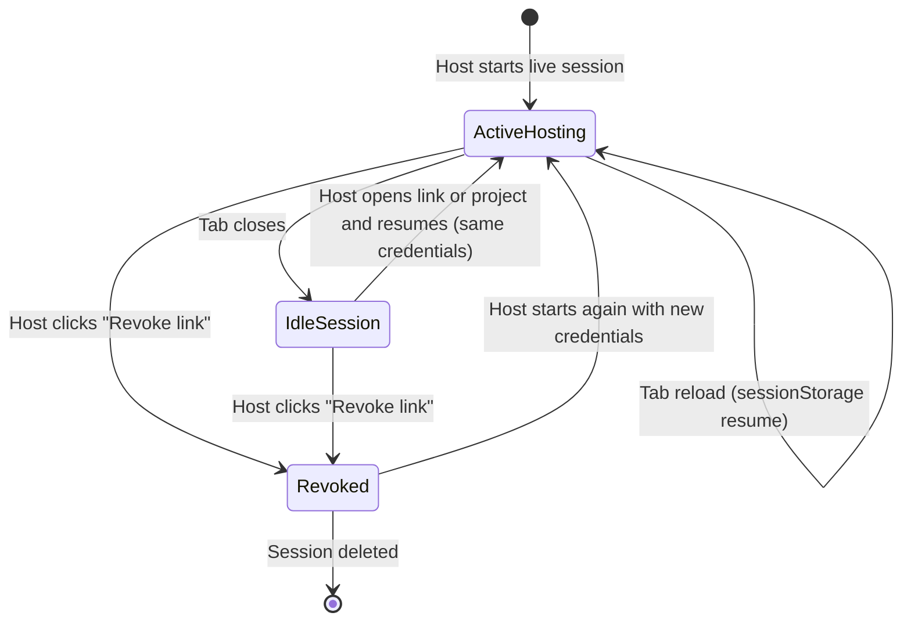
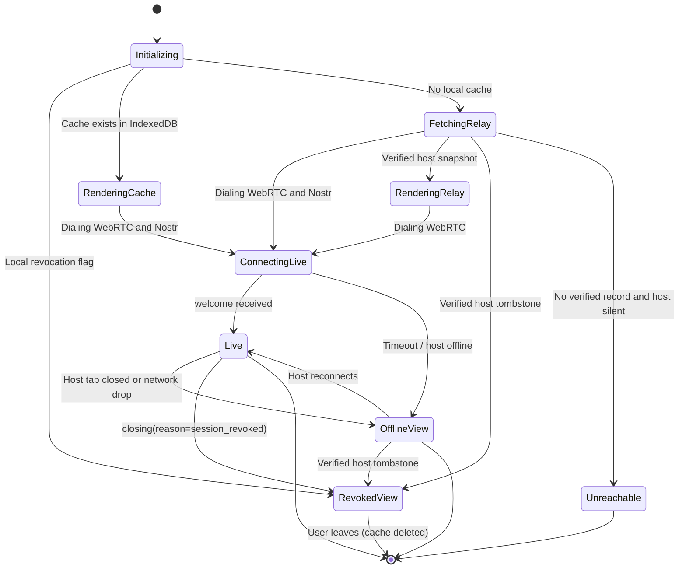
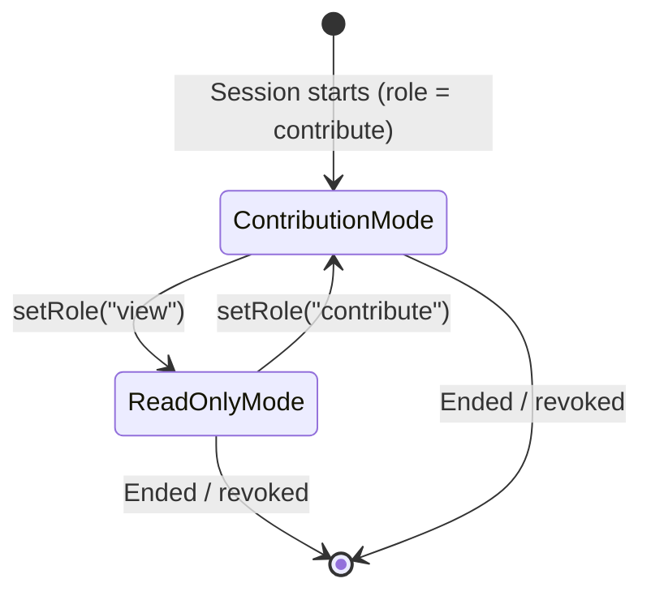

# Data Model: Restore Shared Sessions Across Devices and Disconnects

**Feature**: `006-restore-shared-sessions` | **Date**: 2026-10-11

This file is the single source of truth for the shapes below. [research.md](./research.md) and
[contracts/session-restore.md](./contracts/session-restore.md) refer to these definitions instead of repeating them.

## Entities & Schemas

### 1. Host Session Record (`localStorage`)

Extends today's `deci.live.host.<projectKey>` value (`SessionCredentials`) with a host-only signing secret.

- **Key**: `deci.live.host.<projectKey>`
- **Value**: JSON of `HostSessionRecord`

```ts
interface HostSessionRecord extends SessionCredentials {
  sessionId: string;       // 12-char base64url (randomId(9)) — in the link
  secret: string;          // 128-bit base64url — in the link
  /** 256-bit base64url; NEVER leaves this browser. Seeds the relay signing key. */
  relaySecret: string;
  createdAt: string;       // ISO-8601
}
```

- **Derived**: `hostKeyPair = schnorrKeyFrom(HKDF-SHA256(relaySecret, salt="deci-live/relay", info=sessionId))`. `hostKey = hex(xOnlyPubkey)` (64 hex chars, sent as 43-char base64url in the link).
- **Migration**: a record without `relaySecret` gets one generated on first read. The link for it then gains the `hostKey` segment (see §2).

### 2. Join Link

```
#/join/:sessionId/:secret[/:hostKey]
```

- `hostKey` is optional so links shared before this feature keep working. Without it, guests pin the key from the host's `welcome` (TOFU, see §4) and ignore relay records until then.
- The link never contains `relaySecret`.

### 3. Host Session Index (`localStorage`)

- **Key**: `deci.live.bySession.<sessionId>`
- **Value**: `${store}:${id}` (e.g. `file:project-uuid-1`).
- **Written** whenever `hostCredentialsFor(projectKey)` returns a record. **Removed** on revocation.

### 4. Active Hosting Descriptor (`sessionStorage`)

- **Key**: `deci.live.activeHosting`

```ts
interface ActiveHostingDescriptor {
  projectRef: { store: string; id: string };
  projectTitle: string;
  sessionId: string;
  startedAt: string;      // ISO-8601
  lastHeartbeat: string;  // ISO-8601, refreshed every 30 s while hosting
}
```

- **Written** on `LiveShareProvider.start()`. **Cleared** on explicit `stop()` or revocation.
- **Ignored on boot** if `lastHeartbeat` is older than 1 hour.
- Survives reloads only; `sessionStorage` is dropped when the tab closes (FR-002), after which FR-001 applies.

### 5. Cached Live Session (`IndexedDB`)

- **Database**: `decisionator-store`, object store `live_sessions`, key `sessionId`, index `lastOpenedAt`.

```ts
interface CachedLiveSessionRecord {
  sessionId: string;
  /** Join-link secret the guest already holds (FR-009); deleted with the record. */
  secret: string;
  /** Host verification key — from the link or pinned from the first welcome. */
  hostKey: string | null;
  participantId: string;
  displayName: string;        // what the user typed
  name: string;               // assigned by host ("Gina 2")
  role: "contribute" | "view";
  projectTitle: string;       // for the Joined Sessions list
  rev: number;
  snapshot: ProjectSnapshot;  // redacted, as received
  cachedAt: string;           // first stored
  lastSyncedAt: string;       // last confirmed live or from a verified relay record
  lastOpenedAt: string;       // LRU key
}
```

- **Eviction**: after each write, keep the 30 records with the newest `lastOpenedAt`; delete the rest. A `QuotaExceededError` triggers eviction of the oldest record and one retry.

### 6. Sealed Relay Snapshot Event (Nostr NIP-78)

| Field | Value |
|---|---|
| `kind` | `30078` (parameterized replaceable) |
| `pubkey` | `hostKey` (from §1) |
| `tags` | `[["d", topic], ["t", topic]]` |
| `content` | `seal(signalKey, topic, JSON(RelayPayload))` |
| `sig` | Schnorr signature by the host key |

```ts
type RelayPayload =
  | { v: 1; type: "snapshot"; rev: number; publishedAt: number; snapshot: RedactedSnapshot }
  | { v: 1; type: "tombstone"; publishedAt: number; reason: "revoked" | "ended" };
```

- `signalKey`, `topic` = `deriveSessionKeys({ sessionId, secret })` (unchanged).
- Relays replace by `(pubkey, kind, d)`, so only the host key can replace the host's record. Guests query with `authors: [hostKey]` and drop any event whose signature or `pubkey` does not match.

### 7. Revocation Registry (`localStorage`)

- **Key**: `deci.live.revoked.<sessionId>` → `{ revokedAt: string, reason?: string }`
- Checked by `JoinLivePage` on this device before anything else.

### 8. Live Participant Profile (computed on host, in memory)

```ts
interface LiveParticipantProfile {
  participantId: string;
  name: string;             // latest assigned/display name
  isHost: boolean;
  online: boolean;          // has an open data channel now
  gradeCount: number;       // options with an effective grade (after resets)
  hasBallot: boolean;       // effective ballot in the current round
}
```

- **Source**: the union of (a) connected guests from the host session state, and (b) every `participantId` that authored a grade, ballot, or comment in the current project snapshot. Names come from the live guest record or, for offline participants, the latest entry's author display name.
- Read-only mode applies to the whole session, so the profile carries no role.

### 9. Participant Vote Reset Entries

"Drop votes" appends two entries through the host's normal project write path, the same shapes `ResetDialog` already writes (the store adds id, timestamp, and author):

```ts
const round = snapshot.project.voting?.round ?? 1;
const entries: ResetEntry[] = [
  { kind: "reset", scope: "participant", participantId, targets: ["grades"] },
  { kind: "reset", scope: "participant", participantId, targets: ["ballots"], round },
];
```

Shared helper: `participantVoteResets(participantId, round)` in `apps/web/src/features/history/reset-entries.ts`, used by both `ResetDialog` and the live panel.

### 10. Moderation Proposal (US6, agent API)

```ts
interface ModerationProposal {
  id: string;
  grantId: string;              // agent grant that proposed it
  agentName: string;
  action: "drop_votes" | "set_read_only" | "allow_contributions" | "revoke_link";
  participantId?: string;       // required for drop_votes
  reason: string;               // shown to the owner, ≤ 500 chars
  status: "pending" | "accepted" | "dismissed";
  createdAt: string;
  decidedAt?: string;
}
```

Held in memory by the host tab; decisions are written to the agent audit log (`agent_moderation_accepted` / `agent_moderation_dismissed`).

---

## State Transitions

### 1. Hosted Session Lifecycle



### 2. Guest Connection & Cache State Machine



### 3. Session Contribution Mode


