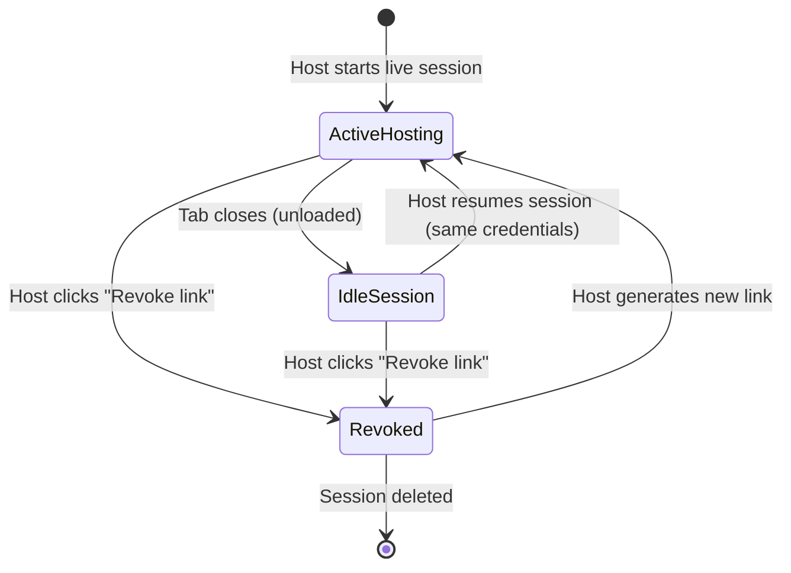
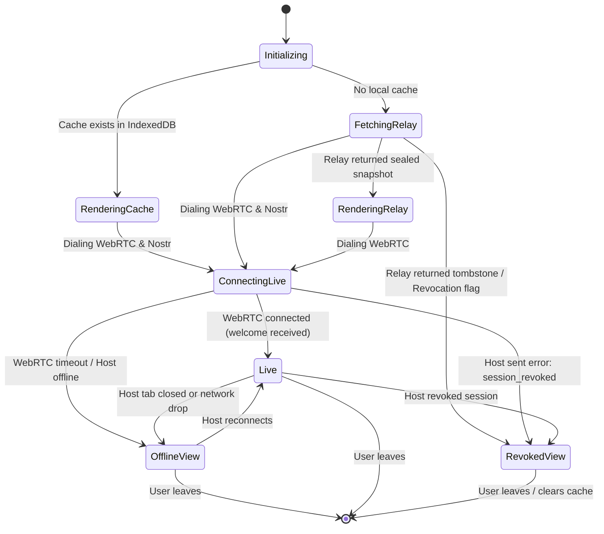
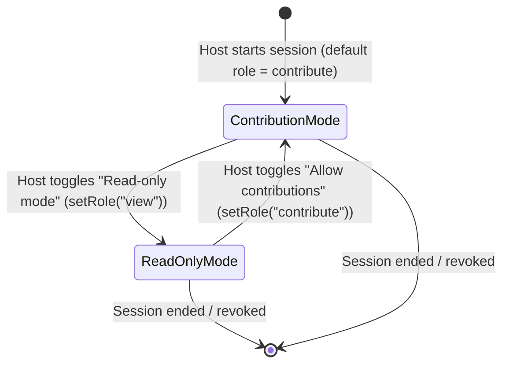

# Data Model: Restore Shared Sessions Across Devices and Disconnects

**Feature**: `006-restore-shared-sessions` | **Date**: 2026-10-11

## Entities & Schemas

### 1. Host Session Index (`localStorage`)

Persists the reverse mapping between a live session's public identifier and the local project reference, allowing the host browser to recognize when it is accessing its own shared link.

- **Storage Location**: `localStorage`
- **Key Pattern**: `deci.live.bySession.<sessionId>`
- **Value**: String in `${store}:${id}` format (e.g., `file:project-uuid-1` or `firestore:fs-doc-9`).
- **Validation**:
  - `sessionId`: 12-character base64url string (`^[A-Za-z0-9_-]{12}$`).
  - `projectKey`: Must conform to `${store}:${id}` with valid store prefix.

---

### 2. Active Hosting Descriptor (`sessionStorage`)

Persists in-flight hosting state across browser tab refreshes (F5), navigation, and temporary tab recovery.

- **Storage Location**: `sessionStorage`
- **Key**: `deci.live.activeHosting`
- **Type**: JSON string of `ActiveHostingDescriptor`

```ts
interface ActiveHostingDescriptor {
  projectRef: {
    store: string;
    id: string;
  };
  projectTitle: string;
  sessionId: string;
  startedAt: string; // ISO-8601 timestamp
  lastHeartbeat: string; // ISO-8601 timestamp
}
```

- **Lifecycle & Invariants**:
  - **Written**: When `LiveShareProvider.start()` successfully binds the host.
  - **Updated**: Heartbeat updated on guest links or project mutations.
  - **Cleared**: When `LiveShareProvider.stop()` is explicitly called by the user.
  - **Expiry**: Ignored on boot if `lastHeartbeat` is older than 1 hour.

---

### 3. Cached Live Session (`IndexedDB`)

Maintains an offline-capable, point-in-time record of deliberations for returning guests.

- **Storage Location**: IndexedDB database `decisionator-store`, object store `live_sessions`
- **Primary Key**: `sessionId`
- **Schema**:

```ts
interface CachedLiveSessionRecord {
  /** The 72-bit random base64url session identifier. */
  sessionId: string;
  /** The 128-bit random base64url secret from the URL fragment. */
  secret: string;
  /** Stable participant ID derived from deviceSecret + sessionId. */
  participantId: string;
  /** The display name typed by the user. */
  displayName: string;
  /** The unique name assigned by the host ("Gina 2"). */
  name: string;
  /** Participant role granted by host. */
  role: "contribute" | "view";
  /** Authoritative revision number from host snapshot. */
  rev: number;
  /** Full project snapshot for offline rendering. */
  snapshot: ProjectSnapshot;
  /** When this record was created. */
  cachedAt: string; // ISO-8601
  /** When this snapshot was last confirmed live with the host. */
  lastSyncedAt: string; // ISO-8601
}
```

---

### 4. Sealed Relay Snapshot Event (Nostr NIP-78)

Enables asynchronous retrieval of the latest decision state when the host is offline, using public Nostr relays without exposing project data.

- **Event Structure**:

| Field | Type | Description |
|---|---|---|
| `kind` | `30078` | NIP-78 Parameterized Replaceable Event |
| `pubkey` | `string` | Ephemeral Schnorr public key (hex) |
| `created_at` | `number` | Unix timestamp in seconds |
| `tags` | `string[][]` | `[["d", <topic>], ["t", <topic>]]` |
| `content` | `string` | Base64URL-encoded ciphertext blob |
| `sig` | `string` | Schnorr signature over canonical event serialization |

- **Ciphertext Payload**:
  - $\text{signalKey} = \text{HKDF-SHA256}(\text{sessionId} \parallel 0 \parallel \text{secret})[0..32]$
  - $\text{aad} = \text{topic} = \text{hex}(\text{HKDF-SHA256}(\dots)[32..64])$
  - $\text{content} = \text{base64url}(\text{nonce}_{12} \parallel \text{AES-256-GCM}(\text{signalKey}, \text{nonce}, \text{JSON}(\text{redactedSnapshot}), \text{aad}))$

---

### 5. Revocation Registry & Tombstone Records

Allows owners to revoke previously shared links and invalidate snapshots on relays.

- **Storage Location (Local)**: `localStorage` key `deci.live.revoked.<sessionId>`
- **Value**: JSON of `{ revokedAt: string, reason?: string }`
- **Relay Tombstone Event**:
  - `kind`: `30078`
  - `tags`: `[["d", <topic>], ["t", <topic>]]`
  - `content`: `base64url(nonce || AES-256-GCM(signalKey, nonce, JSON({ tombstone: true, revokedAt: Date.now() }), aad=topic))`
  - **Invariant**: Any guest opening a link whose topic yields this tombstone immediately enters the `revoked` state.

---

### 6. Live Participant Profile (`in-memory / computed`)

Represents a session participant in the host's administrative roster, combining WebRTC connection status with project submission counts.

- **Storage Location**: Computed in-memory on host from `session.state.guests` and `project` state.
- **Schema**:

```ts
interface LiveParticipantProfile {
  /** Unique participant identifier derived from deviceSecret + sessionId */
  participantId: string;
  /** Resolved human-readable name ("Gina 2") */
  name: string;
  /** Whether this participant is the session host */
  isHost: boolean;
  /** Whether the participant is currently connected via WebRTC data channel */
  online: boolean;
  /** Active WebRTC peer ID if connected */
  peerId?: string;
  /** Total number of options graded by this participant */
  gradeCount: number;
  /** Whether this participant has submitted a ballot in the current round */
  hasBallot: boolean;
  /** Effective role assigned to this participant */
  role: "contribute" | "view";
}
```

- **Drop Votes Reset Entry**:
  When the host drops votes for `participantId`, an append-only entry is added to the project journal:
  ```ts
  interface ParticipantResetEntry {
    id: string; // UUID
    timestamp: string; // ISO-8601
    author: AuthorSignature; // host identity
    kind: "reset";
    scope: "participant";
    participantId: string;
    targets: ("grades" | "ballots")[];
  }
  ```

---

## State Transitions

### 1. Hosted Session Lifecycle



### 2. Guest Connection & Cache State Machine



### 3. Session Contribution Mode Lifecycle




